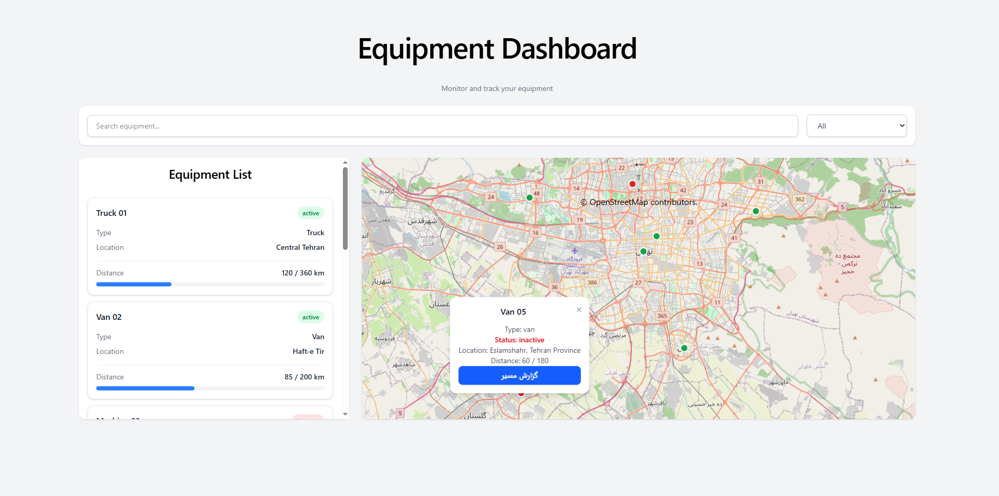

# Map Dashboard

A web-based equipment monitoring dashboard built with React, TypeScript, and OpenLayers.

The application provides an interactive map for monitoring equipment locations, searching and filtering equipment, viewing equipment details, and displaying routes between origin, current location, and destination.

## Live Demo
[View Live Demo] ([map-dashboard-ecru.vercel.app](https://map-dashboard-ecru.vercel.app/))

## Screenshot




## Features

- Interactive map powered by OpenLayers and OpenStreetMap
- Display equipment locations on the map
- Visual status indicators for active and inactive equipment
- Equipment list with selectable equipment cards
- Search equipment by name
- Filter equipment by status
- Synchronization between the equipment list and the map
- Highlighting and animated pulse effect for the selected equipment
- Equipment information popup on map marker click
- Route visualization from origin to current location to destination
- Route origin and destination markers
- Automatic map centering and zooming when an equipment item is selected
- Responsive dashboard layout

## Technologies

- React
- TypeScript
- OpenLayers
- OpenStreetMap
- Vite
- CSS
- React Router

## Project Structure

```text
src/
├── components/
│   ├── EquipmentItem.tsx
│   ├── EquipmentList.tsx
│   ├── MapView.tsx
│   ├── SearchBox.tsx
│   ├── StatusFilter.tsx
│   └── index.ts
│
├── data/
│   ├── mockEquipment.ts
│   └── index.ts
│
├── pages/
│   └── DashboardPage.tsx
│
├── services/
│   └── index.ts
│
├── types/
│   └── index.ts
│
├── App.tsx
├── App.css
├── index.css
└── main.tsx
```

## Getting Started

### Prerequisites

Make sure you have Node.js and npm installed.

### Installation

Clone the repository:

```bash
git clone https://github.com/zahranasiri01/map-dashboard.git
```

Navigate to the project directory:

```bash
cd map-dashboard
```

Install dependencies:

```bash
npm install
```

Start the development server:

```bash
npm run dev
```

Open the local development URL shown in the terminal.

## How It Works

The dashboard consists of two main areas:

### Equipment List

The equipment panel allows users to:

- Search for equipment
- Filter equipment by status
- Select an equipment item
- View basic equipment information

Selecting an equipment item updates the map and moves the map view to its location.

### Interactive Map

The map displays equipment locations using OpenLayers.

Equipment markers use different colors to represent their current status:

- Green — Active
- Red — Inactive

The selected equipment receives an additional visual highlight and a short pulse animation to make its location easier to identify on the map.

### Equipment Details

Clicking an equipment marker opens a popup containing information about the selected equipment.

The popup also provides access to the route report.

### Route Visualization

The route report displays a simple route consisting of:

```text
Origin → Current Location → Destination
```

The route is displayed directly on the map, together with separate origin and destination markers.

## Data Model

Equipment data is currently provided through mock data.

Each equipment item contains information such as:

- ID
- Name
- Type
- Status
- Origin
- Destination
- Current location
- Distance traveled
- Total distance

The application structure allows the mock data layer to be replaced by a real API in the future.

## Future Improvements

Possible future improvements include:

- Connecting the dashboard to a real backend API
- Real-time equipment location updates
- Real routing through a routing service
- Authentication and user management
- Advanced equipment filtering
- Improved mobile responsiveness
- Additional map layers and geographic analysis

## Purpose

This project was developed as a portfolio project to demonstrate practical experience with React, TypeScript, interactive maps, API-oriented application architecture, and component-based frontend development.